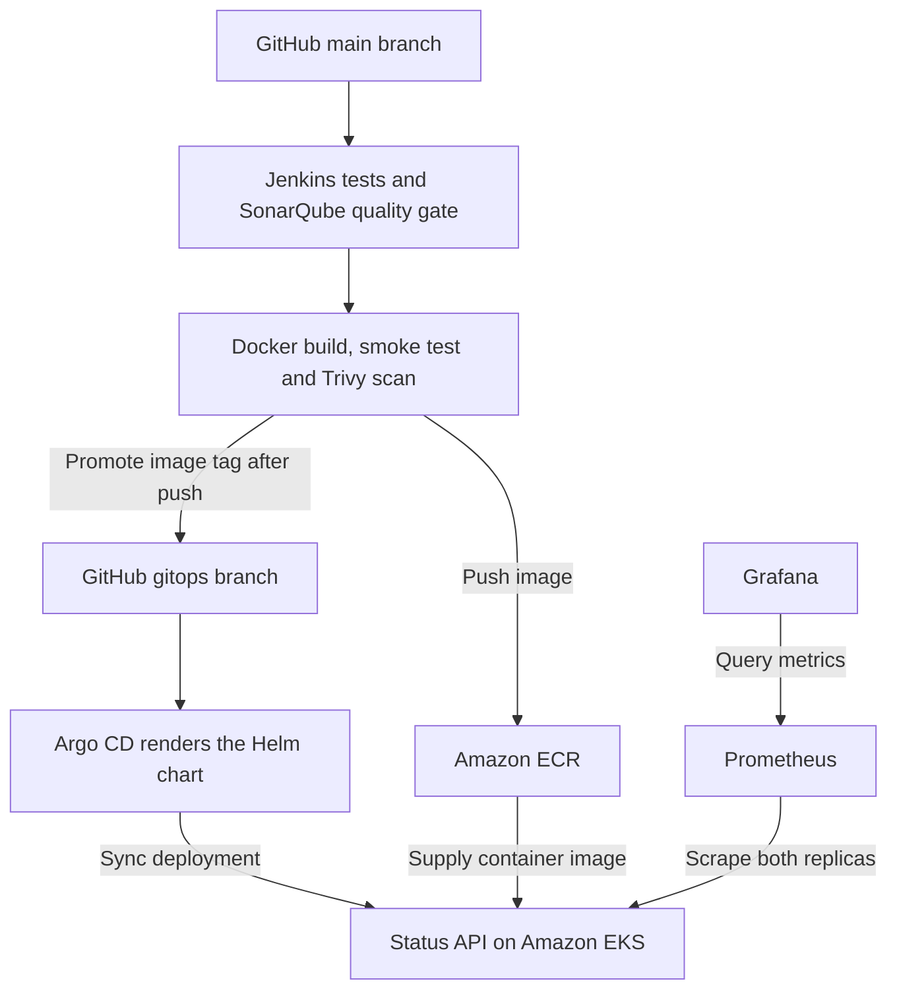
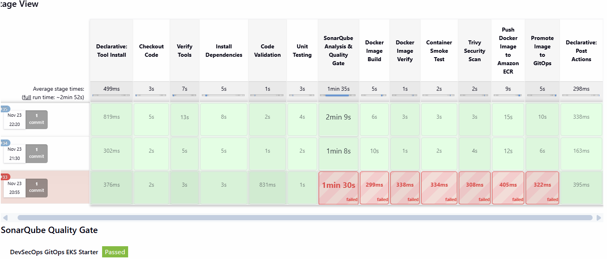
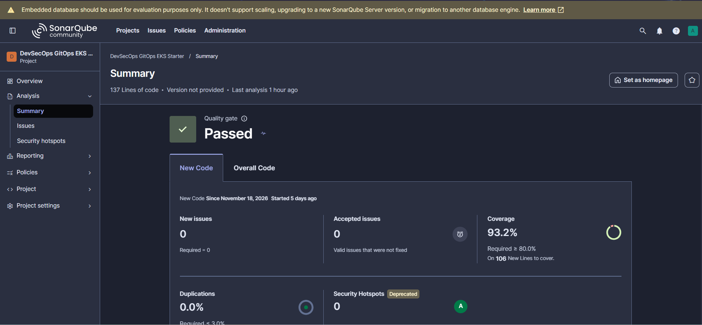
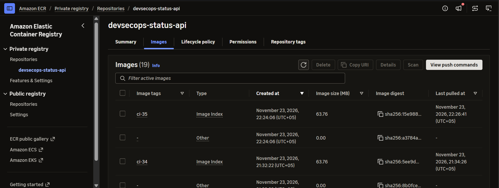
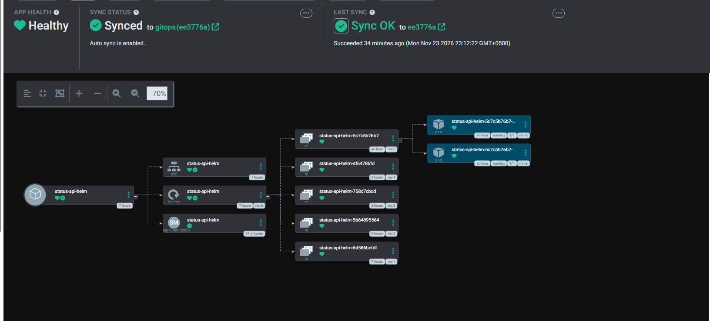
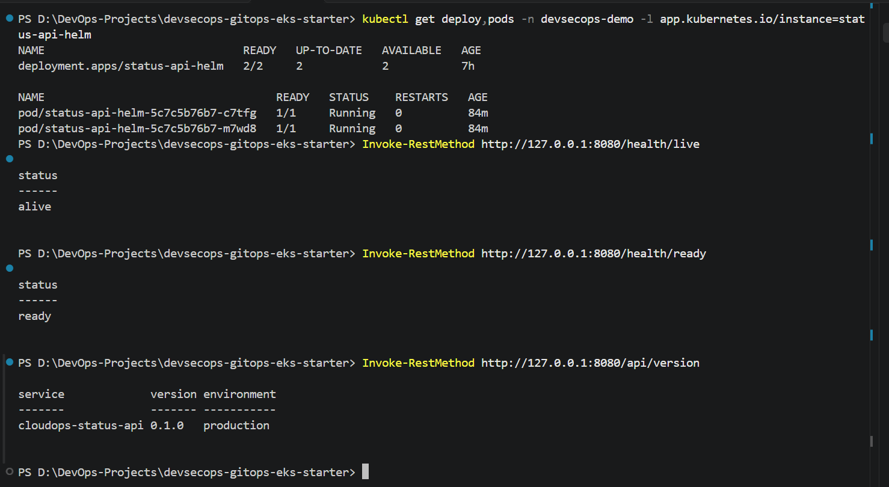
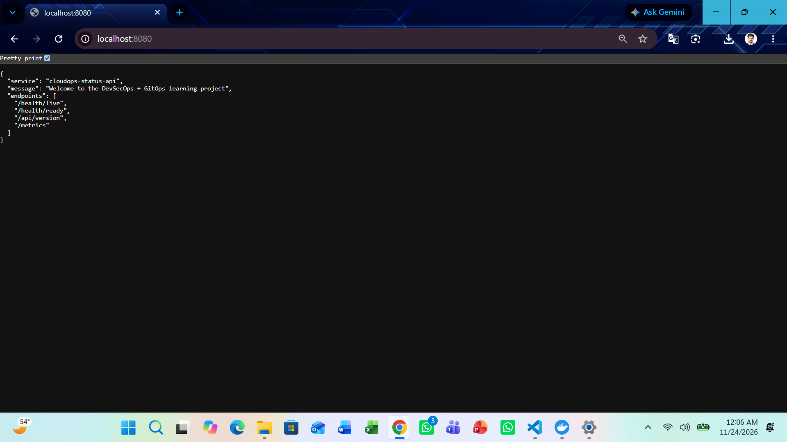
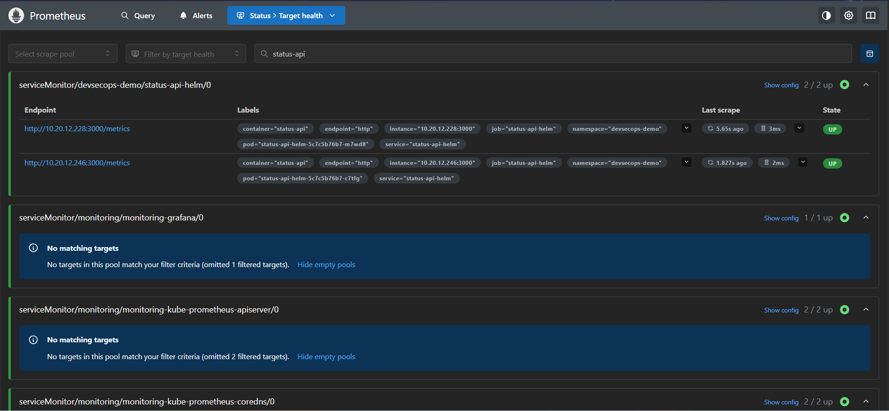
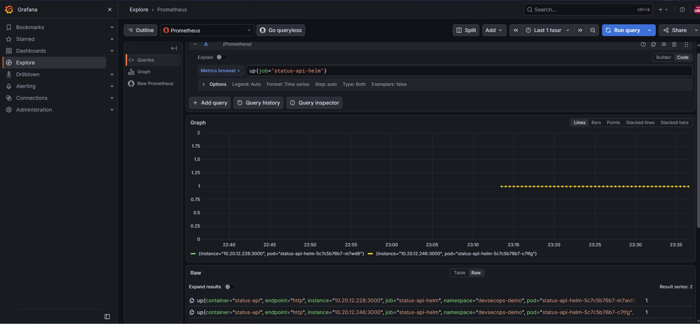
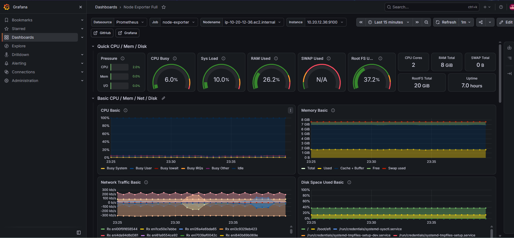

# End-to-End DevSecOps and GitOps on Amazon EKS

A Cloud and DevOps portfolio project by **Anees Ahmad**.

This project follows a Node.js status API from a GitHub commit to two running replicas on Amazon EKS. Jenkins tests the application, checks code quality, scans the container image, and publishes it to Amazon ECR. Jenkins then updates the image tag in Git. Argo CD deploys that release to EKS, where Prometheus and Grafana monitor both replicas.

## Verified release

| Check | Observed result |
| --- | --- |
| Jenkins pipeline | Build `#35` passed testing, quality analysis, container scanning, image publication, and GitOps promotion |
| SonarQube | Quality gate passed with **93.2% new-code coverage** against an 80% threshold |
| Amazon ECR | Image published with tag `ci-35` |
| Argo CD | Application `status-api-helm` reported **Synced** and **Healthy** |
| Amazon EKS | Deployment reported **2/2 replicas ready** in `devsecops-demo` |
| Application | Health endpoints returned `alive` and `ready`. The version endpoint returned `0.1.0` and `production` |
| Prometheus and Grafana | Both API scrape targets were **UP**. Grafana returned two `up` series with value `1` |

## Architecture

The pipeline produces two release artifacts. ECR holds the container image, and the `gitops` branch records the image tag that Argo CD should deploy.



## Release workflow

| Step | What happens |
| --- | --- |
| 1. Trigger | Jenkins detects a change on `main` through SCM polling and checks out the revision on its build agent. |
| 2. Test | Jenkins installs dependencies, checks JavaScript syntax, and runs the Node.js tests. `c8` generates the LCOV coverage report. |
| 3. Check quality | SonarQube imports `app/coverage/lcov.info`. Jenkins waits for the quality gate result before building the image. |
| 4. Build and scan | Jenkins builds the Docker image, verifies it, runs a container smoke test, and scans the image with Trivy. |
| 5. Publish and promote | Jenkins pushes the image to Amazon ECR and updates the desired image tag on the `gitops` branch. |
| 6. Deploy | Argo CD tracks `charts/status-api` on `gitops`, renders the Helm chart with `values-eks.yaml`, and syncs it to `devsecops-demo`. |
| 7. Monitor | A ServiceMonitor selects the API Service by label. Prometheus scrapes `/metrics` on each replica every 30 seconds. Grafana displays the results. |

## Application endpoints

`cloudops-status-api` is a small HTTP service with routes for Kubernetes probes, release verification, and Prometheus monitoring.

| Endpoint | Purpose |
| --- | --- |
| `GET /` | Returns the service name and available endpoints as JSON |
| `GET /health/live` | Returns `alive` for the liveness probe |
| `GET /health/ready` | Returns `ready` for the readiness probe |
| `GET /api/version` | Returns the service name, application version, and environment |
| `GET /metrics` | Exposes Prometheus metrics through `prom-client` |

The application version was `0.1.0`. The image tag `ci-35` identifies the Jenkins build that packaged that version. The browser screenshot below shows the EKS application accessed through a local port-forward to its `ClusterIP` Service.

## Project structure

| Path | Contents |
| --- | --- |
| `app/` | Node.js source code, tests, package configuration, and Dockerfile |
| `Jenkinsfile` | CI pipeline, image publication, and GitOps promotion |
| `sonar-project.properties` | SonarQube project settings and LCOV report path |
| `charts/status-api/` | Helm chart, EKS values, Deployment, Service, and ServiceMonitor |
| `terraform/eks/` | Terraform configuration for the AWS lab |
| `k8s/` | Kubernetes manifests used for local practice |
| `compose.yaml` | Local Docker Compose configuration |
| `docs/screenshots/` | Screenshots from the verified release |

## Run the API locally

From the repository root, install the dependencies, run the checks, and start the server. The verified Jenkins build used Node.js 24.

```sh
cd app
npm ci
npm run check
npm test
npm start
```

Keep the server running. Open a second PowerShell terminal and check the API.

```powershell
Invoke-RestMethod http://localhost:3000/health/ready
Invoke-RestMethod http://localhost:3000/api/version
```

To run the containerized application, stop the local Node.js process with `Ctrl+C`, then run these commands from the repository root.

```sh
docker compose up --build -d
docker compose ps
docker compose logs status-api
```

## Verify the deployment on EKS

These commands assume the lab cluster is running and the AWS CLI has access to it.

### 1. Connect to the cluster

```powershell
aws eks update-kubeconfig --region us-east-1 --name devsecops-eks-cluster
kubectl get nodes
```

### 2. Check the GitOps application and Kubernetes resources

```powershell
kubectl get application status-api-helm -n argocd
kubectl rollout status deployment/status-api-helm -n devsecops-demo
kubectl get deploy,pods,svc -n devsecops-demo -l app.kubernetes.io/instance=status-api-helm
kubectl get servicemonitor status-api-helm -n devsecops-demo
```

### 3. Check the running API

Forward a local port to the Kubernetes Service.

```powershell
kubectl port-forward -n devsecops-demo svc/status-api-helm 8080:80
```

Keep that terminal open. In a second PowerShell terminal, run the endpoint checks.

```powershell
Invoke-RestMethod http://localhost:8080/health/live
Invoke-RestMethod http://localhost:8080/health/ready
Invoke-RestMethod http://localhost:8080/api/version
```

Open `http://localhost:8080/` in a browser to see the service name and endpoint list.

### 4. Check monitoring in Grafana

Open **Grafana → Explore**, select the **Prometheus** data source, switch to **Code**, and run this query.

```promql
up{namespace="devsecops-demo", job="status-api-helm"}
```

For the verified release, Grafana returned one series per pod. Both had a value of `1`, meaning Prometheus successfully scraped both targets. The two lines overlap on the graph because their values are identical.

## Project screenshots

### 1. Jenkins pipeline

Build `#35` passed the quality gate, image scan, ECR push, and GitOps promotion.



### 2. SonarQube quality gate

New-code coverage reached **93.2%**, above the required **80%**.



### 3. Amazon ECR image

The `ci-35` tag connects the container image in ECR to the Jenkins build that produced it.



### 4. Argo CD application

Argo CD reported the `status-api-helm` application as **Synced** and **Healthy**.



### 5. EKS deployment verification

Kubernetes reported two ready replicas. The API responded to health and version requests through the forwarded Service.



### 6. API response in the browser

The root route returned the service name and available endpoints as JSON.



### 7. Prometheus targets

Prometheus discovered both pod endpoints through the ServiceMonitor and reported **2/2 UP**.



### 8. Grafana application monitoring

The query result shows two individual scrape targets, each with a value of `1`.



### 9. Grafana worker-node monitoring

The Node Exporter dashboard shows CPU, memory, filesystem, and network activity for the selected EKS worker node.



## Troubleshooting and learning outcomes

### Passing tests while SonarQube reported 0% coverage

The unit tests passed, but SonarQube initially reported **0% new-code coverage**. I added a test for `/metrics`, generated an LCOV report with `c8` during the Jenkins test stage, and configured SonarQube to import `app/coverage/lcov.info`. The quality gate subsequently passed with **93.2% new-code coverage**.

### A healthy Argo CD application with a missing ServiceMonitor

The ServiceMonitor rendered correctly in a local Helm preview on `main`. Argo CD showed **Synced** because the cluster matched the `gitops` branch it tracked. Checking the deployed Git revision revealed that the new template still needed to reach that branch. After I promoted the chart change, Argo CD created the ServiceMonitor and Prometheus discovered both replicas.

### Reducing vulnerabilities in the runtime image

In an earlier remediation exercise, Trivy reported **6 HIGH** and **0 CRITICAL** findings for image `ci-6`. I removed unnecessary npm, Yarn, and Corepack components from the runtime image and rebuilt it. The scan of `ci-8` reported **0 HIGH** and **0 CRITICAL** findings.

The Helm deployment also runs the application as a non-root user, drops Linux capabilities, uses a read-only root filesystem, and disables privilege escalation.

## Cleanup

Stop the local port-forward with `Ctrl+C`. To stop the local Compose application, run this from the repository root.

```sh
docker compose down
```

For an AWS lab teardown, first confirm the AWS account and Terraform workspace, then review the proposed resource deletions.

```powershell
aws sts get-caller-identity
terraform -chdir=terraform/eks workspace show
terraform -chdir=terraform/eks plan -destroy
```

If retiring the lab, review the destruction plan before confirming `terraform -chdir=terraform/eks destroy`. Check resources created outside that Terraform state separately.

## Future improvements

- Add a Grafana alert for missing or failing API scrape targets.
- Test a GitOps rollback and record the restored image tag and recovery time.
- Build a browser status dashboard using the existing health and version endpoints.

## Author

**Anees Ahmad**  
AWS Certified Solutions Architect – Associate  
BS Information Technology

[GitHub profile](https://github.com/aneesahmad081)