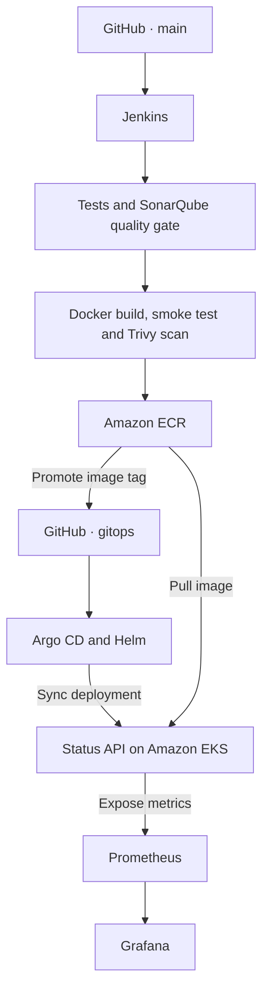

☁️ End-to-End DevSecOps and GitOps on Amazon EKS
A Cloud and DevOps portfolio project by Anees Ahmad.

This project follows a Node.js API from a commit on GitHub to two running replicas on Amazon EKS. Jenkins tests the application, checks code quality, builds and scans its container image, and publishes the image to Amazon ECR. Argo CD reads the deployment configuration from Git and applies the Helm chart to EKS. Prometheus and Grafana show whether each replica can be scraped after deployment.

Verified release: Jenkins build #35 published image ci-35. Argo CD reported Synced and Healthy, Kubernetes reported 2/2 replicas ready, and Prometheus reported 2/2 scrape targets up.
🏗️ Architecture
Two artifacts connect CI to the running application. Amazon ECR stores the image that Jenkins built. The GitOps branch records which image Kubernetes should run.

📸 Project Screenshots
1. Jenkins pipeline

Build #35 completed the image scan, ECR push and GitOps promotion.
2. SonarQube quality gate

New-code coverage reached 93.2%, above the 80% gate threshold.
3. Amazon ECR image

The ci-35 tag links the release artifact to its Jenkins build.
4. Argo CD resource tree

The application is Healthy and Synced to the gitops branch.
5. EKS deployment and probes

Both replicas are ready. The live and ready probes and version endpoint respond through the forwarded service.
6. API response in the browser

The root endpoint lists the service and its routes. The browser reached the ClusterIP service through kubectl port-forward.
7. Prometheus scrape targets

Both pod endpoints are UP in the status-api-helm scrape pool.
8. Grafana application monitoring

The query returns two series. Both have value 1, so the two lines overlap on the graph.
9. Grafana worker-node monitoring

Node Exporter reports CPU, memory, network and filesystem activity for the selected worker.
📂 Project Structure
devsecops-gitops-eks-starter/
├── app/                    # Node.js service, Dockerfile and tests
├── charts/status-api/       # Helm templates and EKS values
├── terraform/eks/           # EKS infrastructure configuration
├── k8s/                     # Local Kubernetes manifests
├── docs/screenshots/        # Verified release evidence
├── Jenkinsfile              # Build, quality gate, scan and promotion
├── sonar-project.properties # Analysis scope and LCOV report path
├── compose.yaml             # Local container setup
└── README.md
🛠️ Technologies Used
Layer	Tools	Role
Infrastructure	Terraform, Amazon EKS	Define the AWS lab and run Kubernetes workloads
Integration	GitHub, Jenkins	Track source changes and execute the pipeline
Quality and security	Node.js test runner, c8, SonarQube, Trivy	Test routes, measure coverage and scan the built image
Packaging	Docker, Amazon ECR	Build and store versioned images
Delivery	Helm, Argo CD	Render manifests and reconcile the cluster with Git
Monitoring	Prometheus, Grafana, Node Exporter	Observe scrape health and worker resource usage

🌐 Application Endpoints
cloudops-status-api is a small HTTP service that makes a deployment easy to exercise and observe.
Endpoint	Response or purpose
GET /	JSON describing the service and its available endpoints
GET /health/live	Returns alive for the Kubernetes liveness probe
GET /health/ready	Returns ready for the readiness probe
GET /api/version	Returns the service name, application version, and environment
GET /metrics	Exposes Prometheus metrics through prom-client

The verified deployment returned application version 0.1.0 in the production environment. The image tag ci-35 identifies the Jenkins build that packaged it. The Kubernetes Service is a ClusterIP. The browser verification below used a local port-forward to reach EKS.
📋 Prerequisites
For local development, install Git, Node.js and npm. Docker with Compose supports the container workflow. For the EKS lab, configure AWS CLI access, Terraform, kubectl and Helm. The release workflow assumes a configured Jenkins agent, SonarQube, Trivy, ECR, Argo CD and the Prometheus monitoring stack.
🚀 Deployment Guide
Phase 1 — Run the API locally
From the repository root, use Node.js and npm to install dependencies and run the same application checks used in CI.
cd app
npm ci
npm run check
npm test
npm start
In a second PowerShell terminal:
Invoke-RestMethod http://localhost:3000/health/ready
Invoke-RestMethod http://localhost:3000/api/version
For the containerized version, stop the local Node.js server first. From the repository root, run docker compose up --build -d. Use docker compose logs status-api to inspect the service and docker compose down to stop it.
Phase 2 — Review the EKS infrastructure
From the repository root, inspect and plan the configuration for your AWS environment.
aws sts get-caller-identity
terraform -chdir=terraform/eks init
terraform -chdir=terraform/eks plan
For a new lab, review the plan before applying it. For the existing lab in us-east-1, configure kubectl and check the nodes:
aws eks update-kubeconfig --region us-east-1 --name devsecops-eks-cluster
kubectl get nodes
Phase 3 — Build and promote a release
Step	What happens
1. Commit	Jenkins polls the GitHub repository for changes to main and checks out the selected revision on its build agent.
2. Test	The agent installs locked dependencies with npm ci, validates JavaScript syntax, and runs the Node.js tests. The test command generates an LCOV report with c8.
3. Check quality	SonarQube imports the coverage report. Jenkins waits for the quality gate before continuing.
4. Build and scan	Jenkins builds the Docker image, verifies it, runs a container smoke test, and scans the image with Trivy.
5. Promote	Jenkins pushes the versioned image to ECR and updates the desired image tag on the gitops branch.
6. Deploy	Argo CD tracks charts/status-api on gitops, renders the chart with values-eks.yaml, and syncs the application into devsecops-demo.
7. Observe	A ServiceMonitor selects the API Service by its labels. Prometheus scrapes each pod's /metrics endpoint every 30 seconds. Grafana queries the resulting time series.

The branches have distinct roles. main contains the application and CI changes. gitops holds the desired EKS release. Jenkins promotes the image tag automatically. Changes to chart templates also need to reach the branch that Argo CD tracks.
Phase 4 — Verify deployment and monitoring
These commands assume kubectl is connected to the lab cluster and the application has already been deployed.
kubectl get application status-api-helm -n argocd
kubectl get deploy,pods,svc -n devsecops-demo -l app.kubernetes.io/instance=status-api-helm
kubectl get servicemonitor status-api-helm -n devsecops-demo
kubectl port-forward -n devsecops-demo svc/status-api-helm 8080:80
Keep the port-forward running and use a second terminal:
Invoke-RestMethod http://localhost:8080/health/live
Invoke-RestMethod http://localhost:8080/health/ready
Invoke-RestMethod http://localhost:8080/api/version
In Grafana Explore, select the Prometheus data source and run:
up{namespace="devsecops-demo", job="status-api-helm"}
For the verified release, the query returned two series with value 1, one successful scrape for each pod. The HTTP checks above separately verified the application's responses.
🔐 Security and Learning Outcomes
- Passing tests and reporting coverage are separate CI steps. The tests initially passed while SonarQube reported 0% new-code coverage. Adding a metrics endpoint test, generating LCOV during the test run, and pointing SonarQube to app/coverage/lcov.info made the result visible to the gate.
- A healthy GitOps application can still be missing an intended change. The ServiceMonitor rendered locally on main, while Argo CD was synced to gitops. Promoting the chart change to gitops allowed Argo CD to create the monitor. Matching Service labels and the named http port enabled discovery.
- Scan results belong to a specific image. In the earlier remediation exercise, Trivy reported six HIGH and zero CRITICAL findings on ci-6. Removing unnecessary npm, Yarn and Corepack components from the runtime image reduced the reported counts to zero HIGH and zero CRITICAL on ci-8. Build #35 also passed its configured Trivy stage.
- Container runtime controls. The Helm deployment runs the container as a non-root user, drops Linux capabilities, uses a read-only root filesystem and disables privilege escalation.
🧹 Cleanup
Stop local port-forwards with Ctrl+C. Run docker compose down from the repository root to stop a local Compose run. For a disposable AWS lab, confirm the account and Terraform workspace, then preview the resources selected for deletion:
terraform -chdir=terraform/eks workspace show
terraform -chdir=terraform/eks plan -destroy
If the plan matches the lab you intend to remove, use terraform -chdir=terraform/eks destroy and review the confirmation prompt. Check separately for resources created outside that Terraform state.
🚧 Future Improvements
- Add a Grafana alert for missing or failing API scrape targets.
- Exercise a GitOps rollback and record the image tag and recovery time.
- Add a small status dashboard that reads the existing health and version endpoints.
👨‍💻 Author
Anees Ahmad · AWS Certified Solutions Architect – Associate · BS Information Technology